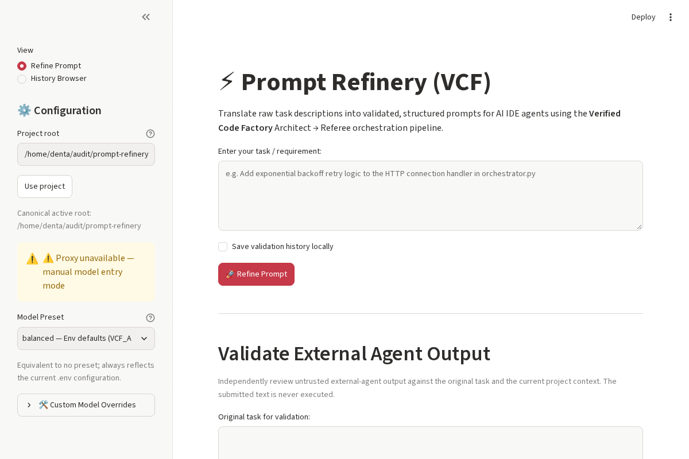

# Prompt Refinery

Verified Code Factory (VCF) – turns raw tasks into validated, contract-checked prompts for AI IDE agents.

[](https://github.com/MilJav11/prompt-refinery/actions/workflows/ci.yml)
[](https://www.python.org/downloads/)
[](./LICENSE)

## At a glance

VCF runs an Architect → Referee loop that drafts a prompt and validates it before anything is written. Every draft must pass Prompt Contract v1, a strict structural contract that keeps instructions concrete and verifiable. On top of the core pipeline sit an MCP server, a Streamlit GUI, and Zed integration for use inside your editor. VCF is a **stateless artifact pipeline**: every instruction it produces is concrete, implementable, and verifiable.

## Quick start

Requires Python 3.11+.

```sh
python -m venv .venv && source .venv/bin/activate  # Windows: .venv\Scripts\activate
pip install -r requirements.txt
cp .env.example .env   # then add your provider API key and model names (see docs/REFERENCE.md)
python vcf.py "Add retry logic to the connection handler"   # writes .zed/prompt.md
streamlit run gui.py                                       # http://localhost:8501
python -m pytest -q   # tests run offline — no API key needed
```



---

## Overview

VCF runs a stateless two-stage orchestration loop with deterministic control flow:

1. **Architect Phase**: Converts a raw user task into a structured prompt draft (with relevant files and assumptions)
2. **Referee Phase**: Validates the draft against Prompt Contract v1 and performs semantic review
3. **Fix Cycle** (if rejected): Gives the Architect feedback for one correction attempt
4. **Finalization**: Writes the approved prompt to `.zed/prompt.md`

The entire pipeline is **stateless** with **deterministic control flow** and **deterministic structural validation**, making it safe to exercise in unit tests with mocked LLM responses and temporary filesystem directories. Note that LLM outputs and semantic review results can vary between runs.

---

## Architect → Referee Flow

```
┌──────────────────────────────────────────────────────────────┐
│  User Task + Project Context                                │
└────────────────────┬─────────────────────────────────────────┘
                     │
                     ▼
         ┌───────────────────────┐
         │    ARCHITECT DRAFT     │
         │  (Pydantic-validated)  │
         └───────────┬───────────┘
                     │
                     ▼
    ┌────────────────────────────────┐
    │ Prompt Contract v1 Structural  │
    │ Validation (det. control flow) │
    └────────┬──────────┬────────────┘
             │          │
         Valid       Invalid
             │          │
             ▼          ▼
    ┌──────────────┐  Synthesize REJECT
    │ Run REFEREE  │  (no LLM call)
    └──┬─────┬────┘
       │     │
    APPROVED REJECT
       │     │
       │     ▼
       │   Feedback Loop
       │   (1 fix cycle max)
       │     │
       │  ARCHITECT DRAFT v2
       │     │
       │  Contract Gate
       │     │
       │     ▼
       │  Run REFEREE
       │     │
       │  APPROVED or REJECT
       │     │
       ▼     ▼
┌──────────────────────┐
│  Write prompt.md     │
│  or review.md        │
└──────────────────────┘
```

---

## Prompt Contract v1

Every approved `zed_prompt` must contain exactly four top-level Markdown section headings, in this precise order, each followed by non-empty content:

### Mandatory Sections

1. **`### 🎯 Objective`**  
   The task to implement. Must be a direct implementation instruction, not a meta-prompt asking for another prompt or plan.

2. **`### 📁 Relevant Files`**  
   List of file paths likely relevant to the task. May be empty (`[]`) if unknown; if included, must be plausible.

3. **`### ⚙️ Technical Requirements & Constraints`**  
   Explicit constraints, edge cases, testing requirements, and any mandatory environment or dependency information.

4. **`### 🚀 Step-by-Step Implementation Instructions`**  
   Numbered or bulleted steps guiding the AI IDE agent through the implementation. Must be concrete and include verification expectations.

### Contract Rules

- **No meta-prompts**: `zed_prompt` must instruct the IDE agent to *do* the work, not describe more work or generate more prompts.
- **Consistency**: `assumptions` and `relevant_files` must not contradict `zed_prompt`.
- **Project knowledge**: Never invent file names, libraries, or framework details. If uncertain, instruct the IDE agent to inspect the project first.
- **Testability**: Each prompt must include clear verification expectations (test suite output, specific file changes, CLI feedback, etc.).

---

## CLI Usage

### Basic Invocation

```sh
python vcf.py "Add retry logic to the connection handler"
```

This will:
1. Load project context (if available)
2. Run the Architect to draft a structured prompt
3. Run the Referee to validate the draft
4. If rejected, give the Architect one chance to fix it
5. Write the approved prompt to `.zed/prompt.md` or diagnostics to `.zed/review.md`

### Command-Line Options

```
usage: vcf.py [-h] [--architect-model ARCHITECT_MODEL]
              [--referee-model REFEREE_MODEL] [--timeout TIMEOUT]
              [--project-root PROJECT_ROOT] [--preset PRESET]
              task

positional arguments:
  task                  The user's task description

optional arguments:
  -h, --help            Show this help message and exit
  --architect-model ARCHITECT_MODEL
                        Override VCF_ARCHITECT_MODEL (always beats --preset)
  --referee-model REFEREE_MODEL
                        Override VCF_REFEREE_MODEL (always beats --preset)
  --timeout TIMEOUT     Override VCF_REQUEST_TIMEOUT (seconds)
  --project-root PROJECT_ROOT
                        Canonical project directory (defaults to VCF_PROJECT_ROOT
                        or the startup directory)
  --preset, -p PRESET   Model preset shortcut (built-in: budget, balanced,
                        deepsense, strict-judge; plus any in presets.json)
```

More CLI examples: [Example Commands](docs/REFERENCE.md#example-commands).

---

## GUI Application

VCF includes a lightweight, single-page web GUI powered by [Streamlit](https://streamlit.io).

### Launching the GUI

```sh
streamlit run gui.py
```

This will automatically open the web interface in your default browser (default: `http://localhost:8501`).

### Features

- **Interactive Task Input**: Enter task descriptions with instant feedback.
- **Preset Selection**: Select model presets (`budget`, `balanced`, `deepsense`, `strict-judge`) from the sidebar.
- **Custom Model Overrides**: Optionally override Architect or Referee models independently.
- **Native Click-to-Copy Output**: Approved prompts and suggested fallback prompts are rendered in Markdown code blocks featuring native copy buttons.
- **History Browser**: Switch the sidebar view to browse previously saved validation runs.
- **Validate External Agent Output**: Independently review output from another agent against the original task.
- **Run Metrics & Diagnostics**: View token counts, estimated costs, and detailed Referee reviews inside collapsible expanders.

---

## Testing

Run the full test suite:

```sh
pytest tests/ -v
```

Run a specific test:

```sh
pytest tests/test_vcf.py::TestApprovedFlow::test_approved_on_first_pass -v
```

The suite (258 tests at the time of writing) runs fully offline; coverage details are in [docs/REFERENCE.md](docs/REFERENCE.md#test-coverage).

## MCP Server

VCF ships a [Model Context Protocol](https://spec.modelcontextprotocol.io) server
(`mcp_server.py`) that exposes the pipeline as a callable tool named
`refine_prompt`.  IDE agents (Zed, Cursor, Antigravity) can invoke VCF directly
without the user running `python vcf.py` manually or copy-pasting
`.zed/prompt.md`. Setup, tool reference and IDE registration: see [Reference](#reference).

## License & Contributing

This project is part of the Prompt Refinery ecosystem. Contributions are welcome; please ensure all tests pass before submitting a pull request.

---
